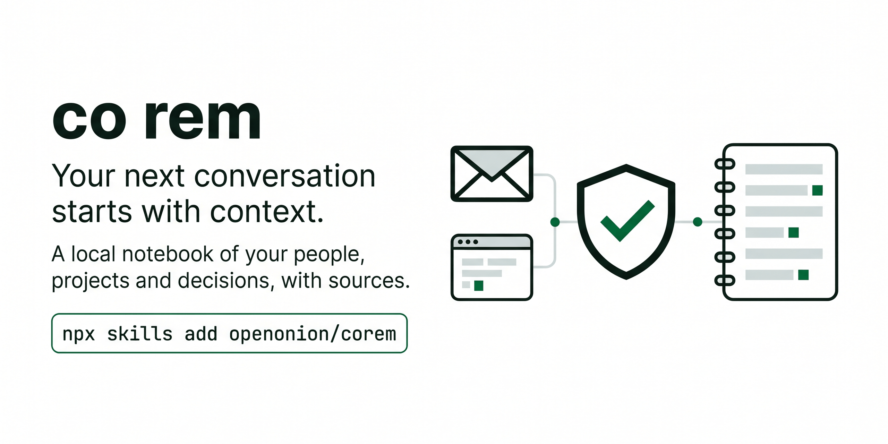
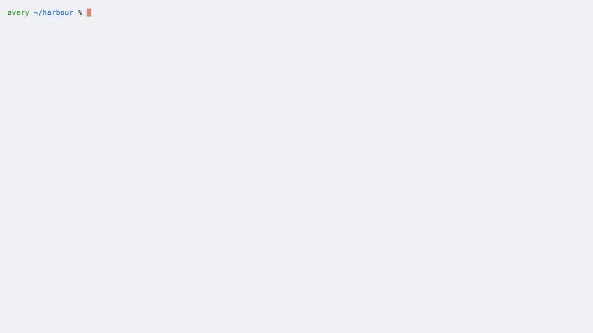
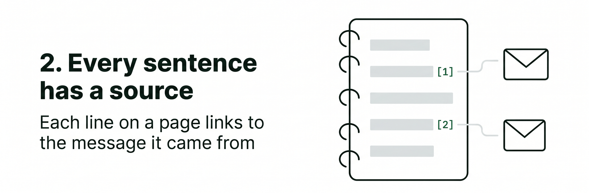
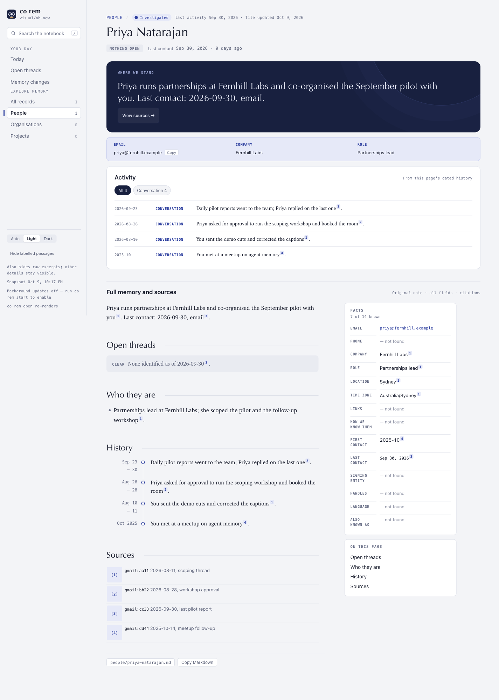
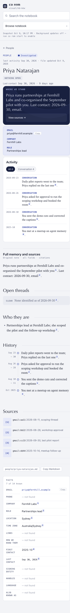

<p align="center">
  <picture>
    <source media="(prefers-color-scheme: dark)" srcset="assets/banner-dark.png">
    
  </picture>
</p>

<h2 align="center">Your next conversation starts with context.<br>People, projects and decisions, every line with its source.<br>A local notebook. Built only on your yes.</h2>

<p align="center">
  <a href="#install"></a>
  <a href="LICENSE"></a>
  <a href="https://discord.gg/4xfD9k8AUF"></a>
</p>

<p align="center">
  
  <br><sub><a href="assets/co-rem.mp4">Watch it</a> · a real terminal and a real Codex session, 1.9.3rc39 · the person, company and project are invented · the setup part plays at about twice real speed</sub>
</p>

<p align="center"><sub>SET UP IN CODEX OR CLAUDE CODE · READ FROM ANY AGENT THAT RUNS A SHELL</sub></p>

## Install

```bash
# the skill
npx skills add openonion/corem

# the co CLI it runs (1.9.3rc41 or later; a preview)
pip install --upgrade --pre connectonion
```

Then tell your agent: **"Set up my memory."** It runs `co init`, which asks you once before reading anything.

<p align="center">
  <picture><source media="(prefers-color-scheme: dark)" srcset="assets/features/1-dark.png"></picture>
  <picture><source media="(prefers-color-scheme: dark)" srcset="assets/features/2-dark.png"></picture>
  <picture><source media="(prefers-color-scheme: dark)" srcset="assets/features/3-dark.png"></picture>
  <picture><source media="(prefers-color-scheme: dark)" srcset="assets/features/4-dark.png"></picture>
</p>

## More

<details>
<summary><b>From the terminal</b></summary>

```bash
co init                                  # identity, mailbox, one yes, upkeep, first pages
co rem show "Mara Ostrowski"             # where you stand with one person, with sources
co rem search "data-sharing addendum"    # across every page
co rem open                              # read the notebook in your browser
co rem status                            # last run, next run, what is waiting on you
co rem stop                              # pause upkeep; co rem start resumes it
```
</details>

<details>
<summary><b>What you get</b></summary>

<p align="center">
  
  
</p>

| Page | What it answers |
|---|---|
| **You** | What you are working on now, who you write to most, what you owe |
| **People** | Who they are, how you know them, what is open between you, dated history |
| **Projects** | Where the work stands, what changed, which sessions moved it |
| **Organisations** | Who you know there, the terms you agreed, what is still open |
| **Skills** | What each installed skill does, how often it ran, how reliable it was |

Every line ends in a numbered source. Pages are Markdown files under `~/.co/rem`; read them with anything.
</details>

<details>
<summary><b>What it reads, and when</b></summary>

`co init` shows the list before asking: your Gmail or Outlook if you connected one, your local Codex and Claude Code sessions, the model it will use (your own Codex plan), the schedule and the daily cap on model calls. Nothing is read until you answer yes. Afterwards the same list is in `co rem sources`; `co rem sources remove gmail` takes one out.

The first run maps 180 days and writes your own page first, then the people and projects you were most recently in touch with. After that a Codex Scheduled task (or launchd) runs the updates at times you saw, reading only what arrived since the last run.
</details>

<details>
<summary><b>Where the data is</b></summary>

- **The notebook stays on your machine**, in `~/.co/rem`, as Markdown files. Nothing is uploaded to ConnectOnion.
- **Model calls go to your own Codex or Claude Code plan**, the way your agent's own turns do. co rem has no model key of its own.
- **Mail bodies are cached locally** so pages can cite them; `co rem stop` pauses upkeep and `co rem sources` shows what is subscribed.
- **Other people's names are masked** when a [handoff](https://github.com/openonion/handoff) leaves your machine.
</details>

<details>
<summary><b>How long, and whose quota?</b></summary>

The estimate `co init` prints before the first page is the honest number for your mailbox: pages, tokens, minutes. A quiet inbox is twenty minutes; a busy one is an hour or two. It runs on your Codex plan and stops at a quota floor so your own work keeps its share; `co rem status` shows today's spend.
</details>

<details>
<summary><b>Which agents and systems work?</b></summary>

Set up in Codex or Claude Code on macOS, Linux or Windows. Scheduled upkeep uses a Codex Scheduled task where the Codex app is installed, and launchd on macOS otherwise. Any agent that can run a shell can read the notebook through `co rem show` and `co rem search`; the skill installs into any agent that `npx skills` supports.
</details>

<details>
<summary><b>What if setup stops halfway?</b></summary>

Run `co init` again. It keeps what exists, says REM is already initialised, and `co rem init` continues the first run where it stopped. Nothing is rebuilt from scratch and nothing is deleted.
</details>

<details>
<summary><b>Copy the skill by hand</b></summary>

The skill is one file: [`skills/co-rem/SKILL.md`](skills/co-rem/SKILL.md). Put it in `~/.codex/skills/co-rem/` or `~/.claude/skills/co-rem/`, or paste it into your agent's instructions.
</details>

<p align="center"><sub>Built with <a href="https://github.com/openonion/connectonion">ConnectOnion</a> · <a href="https://docs.connectonion.com">docs</a> · <a href="https://discord.gg/4xfD9k8AUF">Discord</a></sub></p>
