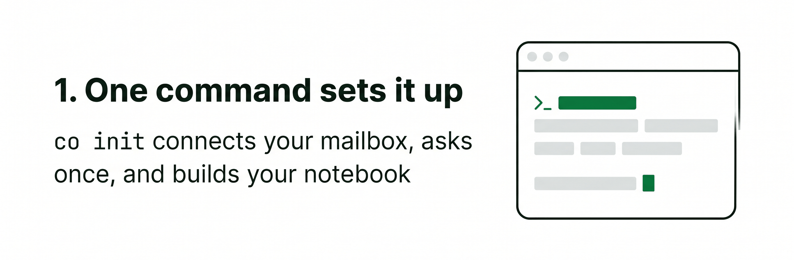
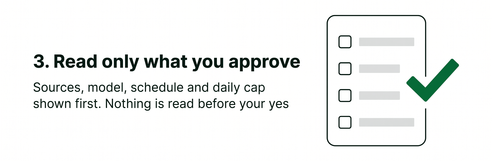
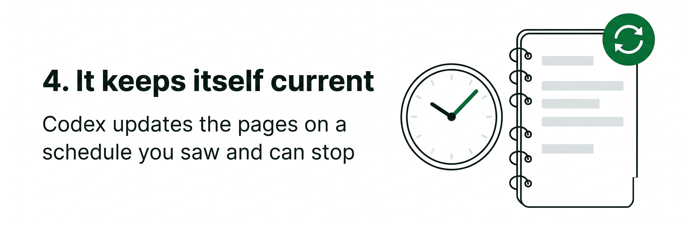

<p align="center">
  <picture>
    <source media="(prefers-color-scheme: dark)" srcset="assets/banner-dark.png">
    
  </picture>
</p>

<h2 align="center">Your next conversation starts with context.<br>People, projects and decisions, every line with its source.<br>A local notebook. Built only on your yes.</h2>

<p align="center">
  <a href="#codex-directory"></a>
  <a href="#install"></a>
  <a href="LICENSE"></a>
  <a href="https://discord.gg/4xfD9k8AUF"></a>
</p>

<p align="center">
  
  <br><sub><a href="assets/co-rem.mp4">Watch the historical preview</a> · a real terminal and Codex session, 1.9.3rc39 · invented person, company and project · setup plays at about twice real speed. Current CLI setup proceeds automatically; the plugin explains and confirms its effects before initialization.</sub>
</p>

<p align="center"><sub>SET UP IN CODEX OR CLAUDE CODE · READ FROM ANY AGENT THAT RUNS A SHELL</sub></p>

## Codex directory

We are preparing REM for submission to the official Codex plugin directory.
The store installation link will appear here after approval and publication.

## Install

**Recommended: paste this prompt into Codex, Claude Code, or another coding
agent that can run a shell.** Your agent installs the CLI and matching plugin
or skill for you.

```text
Install REM from https://github.com/openonion/corem for this coding agent.
Read its README and skills/co-rem/SKILL.md, install the required ConnectOnion
CLI, and use the native plugin if supported or the standalone skill otherwise.
Reuse existing installations. Guide me through setup, and ask me before
reading private sources or enabling scheduled updates.
```

<details>
<summary><b>Manual installation</b></summary>

Choose one entry point. Plugins and the standalone skill share
[`skills/co-rem/SKILL.md`](skills/co-rem/SKILL.md).

#### Codex plugin

```bash
codex plugin marketplace add openonion/corem
codex plugin add rem@rem-marketplace
```

#### Claude Code plugin

Run these commands inside Claude Code:

```text
/plugin marketplace add openonion/corem
/plugin install rem@rem-marketplace
```

#### Standalone skill

```bash
npx skills add openonion/corem
```

#### ConnectOnion CLI

All three entry points need the CLI (1.9.3rc41 or later; a preview):

```bash
pip install --upgrade --pre connectonion
```

Start a new conversation, then tell your agent: **"Set up my memory."**
The Codex plugin also provides a setup entry in supported desktop clients.
The setup skill explains source access, model processing and background work,
then obtains approval before initialization. Current `co init` releases proceed
automatically and can include every connected mailbox and local coding sessions.
Newly connected mailboxes may join future runs. Review the scope before setup.
</details>

<details>
<summary><b>Install from a local checkout</b></summary>

From this repository's root:

```bash
codex plugin marketplace add .
codex plugin add rem@rem-marketplace
```

For Claude Code, run `/plugin marketplace add /absolute/path/to/corem`, then
`/plugin install rem@rem-marketplace`.

The root `plugin.json` packages REM for Codex; `.claude-plugin/` provides the
Claude Code entry. Both load `skills/co-rem/SKILL.md`. These are repository
installation sources, separate from an official plugin-directory listing.
</details>

<details>
<summary><b>Earlier preview screenshots</b></summary>

These panels show an earlier CLI with terminal consent prompts. Current
`co init` proceeds automatically. The REM setup skill explains sources,
model processing and background work and obtains approval before running it.

<p align="center">
  <picture><source media="(prefers-color-scheme: dark)" srcset="assets/features/1-dark.png"></picture>
  <picture><source media="(prefers-color-scheme: dark)" srcset="assets/features/2-dark.png"></picture>
  <picture><source media="(prefers-color-scheme: dark)" srcset="assets/features/3-dark.png"></picture>
  <picture><source media="(prefers-color-scheme: dark)" srcset="assets/features/4-dark.png"></picture>
</p>
</details>

## More

<details>
<summary><b>From the terminal</b></summary>

```bash
co init                                  # identity, mailbox, one yes, upkeep, first pages
co rem show "Mara Ostrowski"             # where you stand with one person, with sources
co rem search "data-sharing addendum"    # across every page
co rem open                              # read the notebook in your browser
co rem status                            # last run, next run, what is waiting on you
co rem stop                              # pause upkeep; co rem start resumes it
```
</details>

<details>
<summary><b>What you get</b></summary>

<p align="center">
  
  
</p>

| Page | What it answers |
|---|---|
| **You** | What you are working on now, who you write to most, what you owe |
| **People** | Who they are, how you know them, what is open between you, dated history |
| **Projects** | Where the work stands, what changed, which sessions moved it |
| **Organisations** | Who you know there, the terms you agreed, what is still open |
| **Skills** | What each installed skill does, how often it ran, how reliable it was |

Every line ends in a numbered source. Pages are Markdown files under `~/.co/rem`; read them with anything.
</details>

<details>
<summary><b>What it reads, and when</b></summary>

The plugin explains the source scope, configured runner and model, quota use,
schedule and task automation before initializing REM. Current `co init` versions
automatically grant local session and connected mailbox access, start the first
build and install upkeep. The CLI's estimate can be informational rather than
an interactive question. Read `co init --help` for the installed version.

Inspect sources with `co rem sources` and remove one with
`co rem sources remove gmail`. Inspect the runner, schedule and task automation
with `co rem config`. Initial source windows and background-update mechanisms
depend on that configuration and CLI version. A later connected mailbox may
join automatically. Use `co rem stop` to pause scheduled updates.
</details>

<details>
<summary><b>Where the data is</b></summary>

- **The notebook stays on your machine**, normally in `~/.co/rem`, with Markdown pages and locally cached evidence.
- **Model calls process selected source material through your configured service**, which can be Codex, Claude Code, or another configured runner. Its privacy settings and usage limits apply.
- **Mail bodies are cached locally** so pages can cite them; `co rem stop` pauses upkeep and `co rem sources` shows what is subscribed.
- Review the [REM privacy notice](PRIVACY.md) for recipients, retention and removal controls.
</details>

<details>
<summary><b>How long, and whose quota?</b></summary>

The CLI estimates pages, tokens and time from available material. Current
releases can continue after printing that estimate. Actual cost and duration
depend on the configured runner, model, source volume and limits.
`co rem status` reports progress and available usage information.
</details>

<details>
<summary><b>Which agents and systems work?</b></summary>

Set up in Codex or Claude Code with local shell access. Background-update
support depends on the installed CLI, host and operating system. Read the setup
output for the mechanism actually installed. Agents with local shell access can
read an existing notebook through `co rem show` and `co rem search`.
</details>

<details>
<summary><b>What if setup stops halfway?</b></summary>

Run `co init` again. It keeps what exists, says REM is already initialised, and `co rem init` continues the first run where it stopped. Nothing is rebuilt from scratch and nothing is deleted.
</details>

<details>
<summary><b>Copy the skill by hand</b></summary>

The skill is one file: [`skills/co-rem/SKILL.md`](skills/co-rem/SKILL.md). Put it in `~/.codex/skills/co-rem/` or `~/.claude/skills/co-rem/`, or paste it into your agent's instructions.
</details>

<p align="center"><sub>Built with <a href="https://github.com/openonion/connectonion">ConnectOnion</a> · <a href="https://docs.connectonion.com">docs</a> · <a href="https://discord.gg/4xfD9k8AUF">Discord</a></sub></p>
